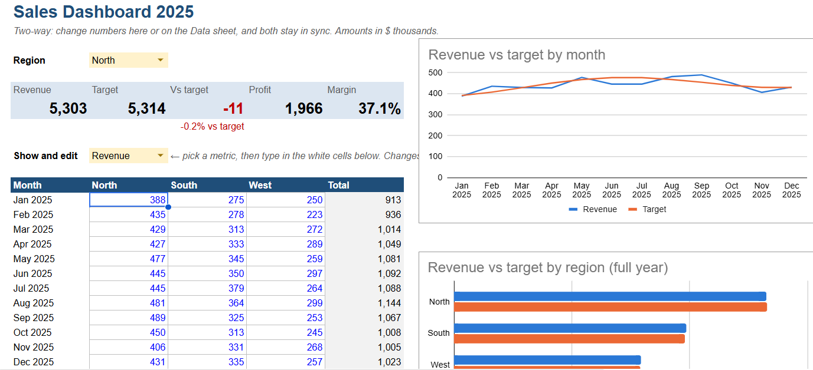

# Two-Way Sales Dashboard in Google Sheets

An interactive Google Sheets dashboard where the numbers can be changed **in either place**. Edit the data sheet and the dashboard updates. Type into the dashboard and the data sheet updates. Both always stay in sync.

**Downloads:** [⬇ Apps Script code (Code.gs)](https://github.com/MuhammedAnshajK/google-sheets-dashboard/raw/main/Code.gs)

**▶ Live sheet (view only):** https://docs.google.com/spreadsheets/d/1bd9iQBiJCzf7vKXI9eyxOX23M9I11TK02naOv24R3XA/edit?usp=sharing · **✎ Make your own editable copy (to try the two-way editing):** https://docs.google.com/spreadsheets/d/1bd9iQBiJCzf7vKXI9eyxOX23M9I11TK02naOv24R3XA/copy

## What it does

- **Dashboard sheet**
  - KPI tiles: revenue, target, variance vs target, profit and margin
  - A region filter
  - Two charts: revenue vs target by month, and by region
  - An editable grid of months x regions. Choose Revenue, Cost or Target and type straight into it.
- **Data sheet**: one row per month and region (36 rows). Profit and margin are formulas.
- **Two-way sync**
  - **Data to dashboard:** every dashboard number is a formula (`SUMIFS`, `INDEX/MATCH`) that reads the Data sheet.
  - **Dashboard to data:** an Apps Script `onEdit` trigger runs when someone types in the grid. It finds the matching month, region and metric on the Data sheet, writes the new value there, and then puts the grid formula back, so the link is never broken.
- **Guard rails:** the KPI and total cells show a warning if someone tries to type over a formula.

## How it works

| Direction | Mechanism |
|---|---|
| Data sheet → Dashboard | Formulas, for example `=SUMIFS(INDEX(Data!C:E,0,MATCH(metric,Data!C1:E1,0)), Data!A:A, month, Data!B:B, region)` |
| Dashboard → Data sheet | `onEdit(e)`: read the edited cell's month (row label), region (column header) and selected metric, find that row on Data, write the value, restore the formula |

The `setup()` function builds the whole workbook from code: both sheets, sample data, formulas, dropdowns, formatting, protections and charts. Anyone can recreate it in a blank Google Sheet in about a minute.

## Set it up (about 2 minutes)

1. Go to **sheets.google.com** and click **Blank spreadsheet**.
2. Click the title (**Untitled spreadsheet**) at the top left and rename it `Sales Dashboard`.
3. In the menu, click **Extensions**, then **Apps Script**. A new tab opens with a code editor.
4. Delete the few lines already in the editor, then open the [plain-text Code.gs](https://github.com/MuhammedAnshajK/google-sheets-dashboard/raw/main/Code.gs), press Ctrl + A and Ctrl + C, and paste it in. (Copying from the normal GitHub page can pick up extra text and cause a syntax error.)
5. Click the **Save** icon (floppy disk).
6. In the toolbar above the code, make sure the dropdown next to **Debug** says `setup`, then click **Run**.
7. Google asks for permission the first time:
   1. Click **Review permissions** and choose your account.
   2. If you see **Google hasn't verified this app**, click **Advanced**, then **Go to Sales Dashboard (unsafe)**. It is your own script, so this is expected.
   3. Click **Allow**.
8. Go back to the spreadsheet tab. You'll see **Dashboard** and **Data** sheets and a message saying "Setup complete".

To test it, type a new number in a white cell on the Dashboard, then open the **Data** sheet. The matching row has changed. Now change a blue number on the Data sheet and go back: the dashboard and charts have updated.

## Files

- `Code.gs`: the complete Apps Script (setup and the two-way sync)

## Tools

Google Sheets, Google Apps Script (JavaScript), SUMIFS, INDEX/MATCH, data validation, triggers
